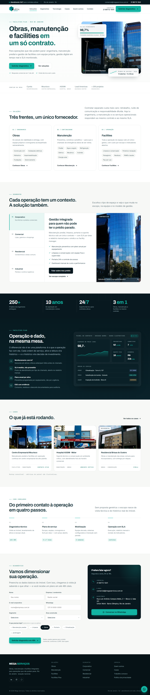

# Mega Serviços — proposta de nova home

Mockup navegável de uma proposta de redesign para [megaservicos.com.br](https://megaservicos.com.br/).

**Ver online:** https://dsalladino.github.io/mega-servicos-mockup/

## O que tem
- Home responsiva em HTML/CSS/JS puro, sem build e sem dependências de framework.
- Seletor de segmento funcional (Corporativo, Comercial, Residencial, Industrial) trocando texto, imagem e CTA.
- Painel de operação ilustrativo (SLA, preventivas, ordens de serviço) para tangibilizar o conceito Facilities Plus.
- Formulário de diagnóstico qualificado (segmento, área, escopo) com estado de envio simulado.
- Marca e fotos reais de contratos reaproveitadas do site atual.

Os números do painel e o SLA são ilustrativos; copy e métricas precisam de validação comercial.

## Revisão de qualidade aplicada
- Acessibilidade: skip link, abas com `role="tab"`/`aria-controls` e navegação por setas/Home/End, menu mobile com Esc, contrastes corrigidos, fieldset no escopo do formulário, foco visível.
- Performance: fotos convertidas para WebP em 400/800px com `srcset`, dimensões declaradas, fontes com `display=swap`.
- SEO/compartilhamento: meta description, canonical, Open Graph/Twitter, JSON-LD de Organization, robots.txt, sitemap.xml e página 404.
- Conversão: CTA do segmento pré-seleciona o segmento no formulário; envio com estado de sucesso.

## Screenshots

